<!--
  Hand-written shell. Every panel is an SVG built by scripts/gen-cards.mjs from
  profile.json plus live GitHub/npm numbers, rebuilt daily by
  .github/workflows/cards.yml and published to the `output` branch, so main
  never receives bot commits. Edit text in profile.json, not in the cards.

  Each panel is a <picture> with a dark and a light variant. Cards paint a
  translucent surface, so they also sit right on Dark dimmed / high contrast.

  Layout rules that keep the page even:
  - Wrap every full-width panel in 
: markdown spaces paragraphs, not bare
    <picture> tags.
  - A two-up row is ONE line with no whitespace between the tags, each half at
    50%. Any space or newline becomes a ~4px inline gap and the second half
    wraps. The visible gap between halves is transparent padding inside the
    SVGs.
-->

<picture><source media="(prefers-color-scheme: dark)" srcset="https://raw.githubusercontent.com/rahulnsanand/rahulnsanand/output/cards/header-dark.svg"><source media="(prefers-color-scheme: light)" srcset="https://raw.githubusercontent.com/rahulnsanand/rahulnsanand/output/cards/header-light.svg"></picture>

  <a href="https://www.rahulnsanand.com" title="rahulnsanand.com"><picture><source media="(prefers-color-scheme: dark)" srcset="https://raw.githubusercontent.com/rahulnsanand/rahulnsanand/output/cards/link-web-dark.svg"><source media="(prefers-color-scheme: light)" srcset="https://raw.githubusercontent.com/rahulnsanand/rahulnsanand/output/cards/link-web-light.svg"></picture></a>
  <a href="https://www.linkedin.com/in/rahulnsanand" title="LinkedIn"><picture><source media="(prefers-color-scheme: dark)" srcset="https://raw.githubusercontent.com/rahulnsanand/rahulnsanand/output/cards/link-linkedin-dark.svg"><source media="(prefers-color-scheme: light)" srcset="https://raw.githubusercontent.com/rahulnsanand/rahulnsanand/output/cards/link-linkedin-light.svg"></picture></a>
  <a href="https://github.com/lyfie-org" title="lyfie-org on GitHub"><picture><source media="(prefers-color-scheme: dark)" srcset="https://raw.githubusercontent.com/rahulnsanand/rahulnsanand/output/cards/link-github-dark.svg"><source media="(prefers-color-scheme: light)" srcset="https://raw.githubusercontent.com/rahulnsanand/rahulnsanand/output/cards/link-github-light.svg"></picture></a>
  <a href="https://discord.gg/KQNsjGAUUz" title="lyfie.org Discord"><picture><source media="(prefers-color-scheme: dark)" srcset="https://raw.githubusercontent.com/rahulnsanand/rahulnsanand/output/cards/link-discord-dark.svg"><source media="(prefers-color-scheme: light)" srcset="https://raw.githubusercontent.com/rahulnsanand/rahulnsanand/output/cards/link-discord-light.svg"></picture></a>
  <a href="https://medium.com/@rahulnsanand" title="Medium"><picture><source media="(prefers-color-scheme: dark)" srcset="https://raw.githubusercontent.com/rahulnsanand/rahulnsanand/output/cards/link-medium-dark.svg"><source media="(prefers-color-scheme: light)" srcset="https://raw.githubusercontent.com/rahulnsanand/rahulnsanand/output/cards/link-medium-light.svg"></picture></a>
  <a href="https://dev.to/rahulnsanand" title="Dev.to"><picture><source media="(prefers-color-scheme: dark)" srcset="https://raw.githubusercontent.com/rahulnsanand/rahulnsanand/output/cards/link-devdotto-dark.svg"><source media="(prefers-color-scheme: light)" srcset="https://raw.githubusercontent.com/rahulnsanand/rahulnsanand/output/cards/link-devdotto-light.svg"></picture></a>
  <a href="https://www.youtube.com/@rahulnsanand" title="YouTube"><picture><source media="(prefers-color-scheme: dark)" srcset="https://raw.githubusercontent.com/rahulnsanand/rahulnsanand/output/cards/link-youtube-dark.svg"><source media="(prefers-color-scheme: light)" srcset="https://raw.githubusercontent.com/rahulnsanand/rahulnsanand/output/cards/link-youtube-light.svg"></picture></a>

<picture><source media="(prefers-color-scheme: dark)" srcset="https://raw.githubusercontent.com/rahulnsanand/rahulnsanand/output/cards/now-dark.svg"><source media="(prefers-color-scheme: light)" srcset="https://raw.githubusercontent.com/rahulnsanand/rahulnsanand/output/cards/now-light.svg"></picture>

<picture><source media="(prefers-color-scheme: dark)" srcset="https://raw.githubusercontent.com/rahulnsanand/rahulnsanand/output/cards/releases-dark.svg"><source media="(prefers-color-scheme: light)" srcset="https://raw.githubusercontent.com/rahulnsanand/rahulnsanand/output/cards/releases-light.svg"></picture>

<!-- One line, no spaces: see the note at the top. -->

<picture><source media="(prefers-color-scheme: dark)" srcset="https://raw.githubusercontent.com/rahulnsanand/rahulnsanand/output/cards/languages-dark.svg"><source media="(prefers-color-scheme: light)" srcset="https://raw.githubusercontent.com/rahulnsanand/rahulnsanand/output/cards/languages-light.svg"></picture><picture><source media="(prefers-color-scheme: dark)" srcset="https://raw.githubusercontent.com/rahulnsanand/rahulnsanand/output/cards/numbers-dark.svg"><source media="(prefers-color-scheme: light)" srcset="https://raw.githubusercontent.com/rahulnsanand/rahulnsanand/output/cards/numbers-light.svg"></picture>

<picture><source media="(prefers-color-scheme: dark)" srcset="https://raw.githubusercontent.com/rahulnsanand/rahulnsanand/output/cards/stack-dark.svg"><source media="(prefers-color-scheme: light)" srcset="https://raw.githubusercontent.com/rahulnsanand/rahulnsanand/output/cards/stack-light.svg"></picture>

